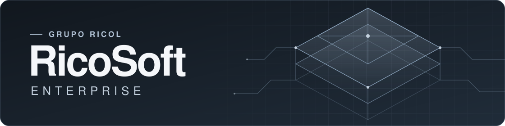

<h1 align="center">
  
</h1>

  Plataforma de gestión empresarial de Grupo Ricol. 
  Reúne la operación comercial, administrativa y de inventario de sus empresas en un solo lugar.

  <a href="#módulos">Módulos</a> &nbsp;·&nbsp;
  <a href="#arquitectura">Arquitectura</a> &nbsp;·&nbsp;
  <a href="#repositorio">Repositorio</a>

## Módulos

| Área | Qué permite |
| :--- | :--- |
| **Gestión comercial** | Gestionar cotizaciones, proformas, pedidos y despachos. |
| **Inventario y disponibilidad** | Consultar existencias, cantidades comprometidas e ingresos proyectados para planificar ventas. |
| **Importaciones** | Dar seguimiento a órdenes, embarques, hitos, documentos y costos. |
| **Gestión humana** | Administrar colaboradores, cargos y expedientes. |
| **Analítica** | Consultar indicadores y resúmenes de operación. |

> **Estado del proyecto** · En desarrollo activo. El acceso a cada módulo depende de la empresa activa, su configuración, los permisos del usuario y la versión desplegada.

## Arquitectura

| Capa | Tecnología |
| :--- | :--- |
| Interfaz web | React, TypeScript, TanStack Router y Vite |
| API | Node.js, Express y TypeScript |
| Persistencia | Prisma ORM y SQL Server |
| Integración ERP | Consultas de solo lectura a Siesa UnoEE |

Cada empresa opera en un tenant propio. La API usa el tenant activo de la sesión y aplica los permisos del usuario en esa empresa.

## Repositorio

- **Aplicación web** · [Código del frontend](src/) y [rutas de la aplicación](src/routes/).
- **API y datos** · [Código del backend](server/src/) y [esquema y migraciones](server/prisma/).
- **Desarrollo** · [Guía del repositorio](AGENTS.md) y [flujo de integración continua](.github/workflows/ci.yml).
