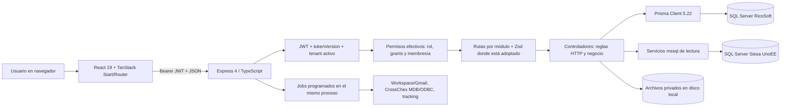
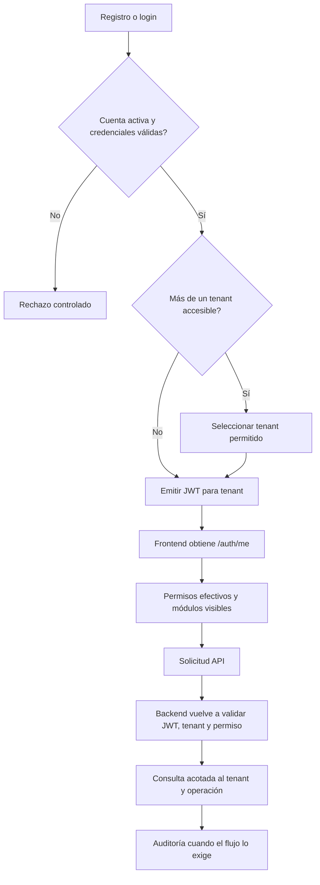
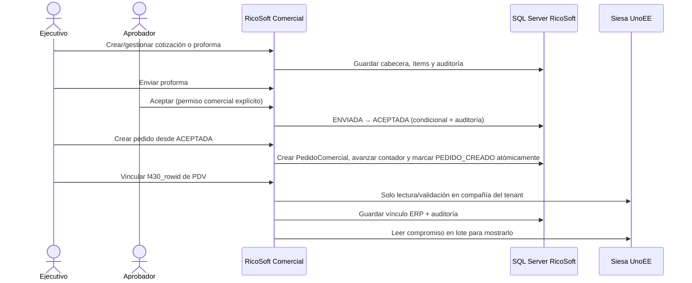
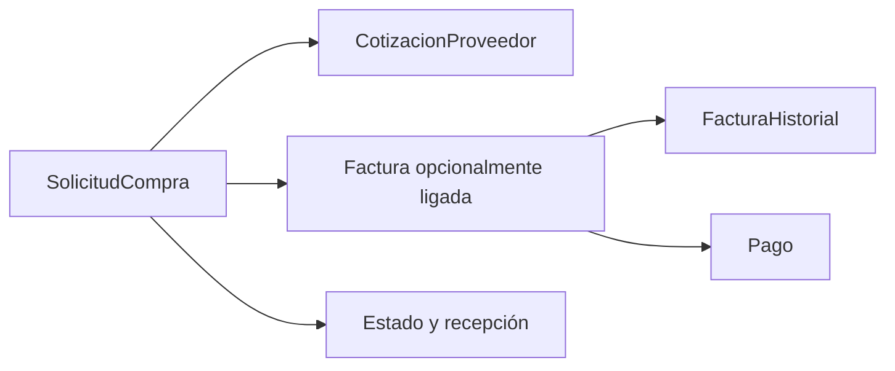
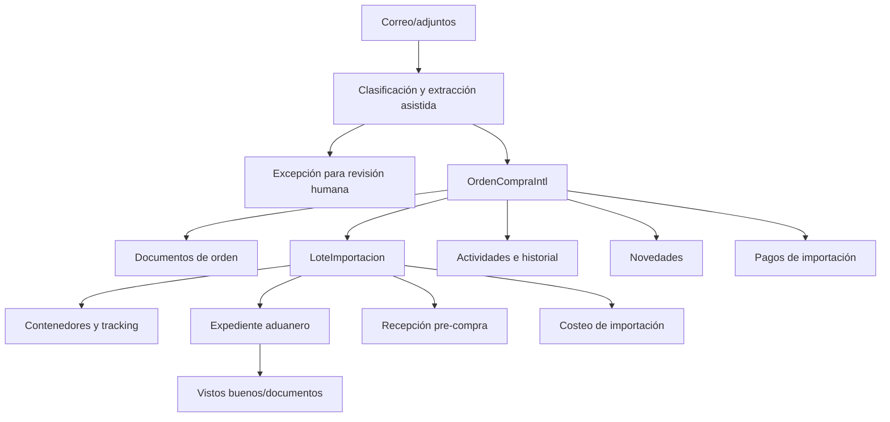

# Arquitectura, requisitos observables y flujos de usuarios — RicoSoft Enterprise

**Fecha:** 2026-10-23
**Base:** `main` en `17a48ae`; análisis de solo lectura de código y documentación del repositorio.
**No verificado:** estado de producción, DNS/HTTPS real, base de datos del futuro servidor, configuración de GitHub Branch Protection y experiencia visual en navegador.

## 1. Resumen ejecutivo

RicoSoft es un monolito modular web multi-tenant: frontend React/TanStack Start/Router y API REST Express/TypeScript, Prisma 5 sobre SQL Server. La API ejecuta controladores por módulo y los controladores acceden directamente a Prisma en la mayoría de las áreas; existen servicios dedicados para algunas integraciones/procesos, pero no una capa Service/Repository uniforme. Siesa UnoEE se consulta mediante una conexión SQL Server externa de solo lectura. El proceso de API también programa jobs de importaciones, tracking, renovaciones y CrossChex.

Inventario verificado en este commit: 38 módulos backend, 38 prefijos API montados, 44 archivos de rutas frontend, 85 modelos Prisma y 73 carpetas de migración. No se ejecutaron pruebas ni se consultó una base en vivo en esta auditoría documental.

**Veredicto de arquitectura:** APTO PARA CONTINUAR DESARROLLO; **NO APTO AÚN PARA DESPLIEGUE INTERNO SIN CERRAR LOS P1 de despliegue** del informe hermano: frontend/URL, HTTPS, migraciones en la base objetivo, backups y aceptación operativa.

## 2. Arquitectura observada

### Capas y límites

- Frontend: 44 rutas basadas en archivos; hooks por dominio y cliente HTTP central (`src/config/api.ts`). El menú se alimenta de módulos/permiso y los guards del navegador mejoran navegación, pero la autorización real debe estar en backend.
- Backend: `server/src/app.ts` monta routers. El patrón normal es Router → autenticación → permiso → validación → Controller → Prisma. En la mayoría de módulos la lógica de negocio y las consultas están dentro del controlador; los servicios se usan de manera selectiva.
- Datos: una base SQL Server de RicoSoft y una conexión Siesa independiente. No confundir entidades locales con filas del ERP; los identificadores `rowId` son referencias externas, no FKs de Prisma.
- Jobs: los schedulers se inicializan desde `server/src/index.ts`, dentro del mismo proceso que sirve HTTP. PM2 define una instancia/fork, coherente con evitar que un mismo job corra duplicado en varios procesos.
- Archivos: archivos sensibles se almacenan en disco local y se entregan por endpoints autenticados en los flujos que lo implementan. El disco pasa a ser estado persistente que debe respaldarse junto con la base.

## 3. Flujo de acceso de usuarios y jerarquía

### Flujo que existe en código

Puntos verificados: login/registro tienen rate limit y validación Zod; el autoregistro crea el usuario inactivo; el selector de empresas deriva las membresías del servidor; el cambio de tenant es un endpoint autenticado. `User.tenantId` representa el tenant principal; `Membresia` puede aportar tenant, rol y departamento alternos. La autorización efectiva considera rol/permisos directos, estado de usuario/rol/membresía y superadmin.

### Jerarquía organizacional: implementado vs. propuesto

El sistema **no codifica** una escalera fija `Gerencia > Jefe > Coordinador > Auxiliar` como niveles inherentes. `Rol` es configurable por tenant y almacena permisos en JSON; existen permisos directos, memberships y `PerfilFuncional` (incluye la marca `esJefeDeArea`). `CargoColaborador` pertenece a Gestión Humana y no otorga permisos de aplicación.

Por eso la siguiente es una **propuesta de asignación inicial para aprobación**, no el comportamiento actual:

| Perfil humano | Acceso recomendado por responsabilidad (propuesta) | Límite de diseño |
|---|---|---|
| Sistemas / Superadmin de tenant | Administración del tenant y soporte transversal según política. | `isSuperadmin` es privilegiado; limitar quién puede concederlo y revisar membresías. No convertirlo en rol cotidiano de todos los sistemas. |
| Gerencia Comercial y Operaciones | Consulta y decisiones comerciales/operativas; aprobación solo con permisos de aprobación explícitos. | No heredar permisos financieros, nómina ni configuración sensible por jerarquía. |
| Gerencia Administrativa y Financiera | Facturas, cartera/crédito, auditoría y configuración asignada. | No otorgar edición comercial ni aprobación de márgenes por defecto. |
| Jefe / Líder de área | Supervisión y aprobaciones de su área según permisos concretos. | El perfil funcional/departamento no debe reemplazar los permisos del backend. |
| Coordinador / Supervisor | Operación, seguimiento y resolución en el alcance del área. | No conceder administración de roles ni aprobaciones ejecutivas automáticamente. |
| Analista / Auxiliar / Ejecutivo | Registro y consulta mínimos para ejecutar tareas asignadas. | No conceder aprobar, eliminar, exportar o administrar sin necesidad aprobada. |

Los templates deben definirse por negocio y cargarse como roles/permisos; no se infieren automáticamente desde el nombre del cargo.

## 4. Requisitos observables / levantamiento

No existe un PRD único. Esta tabla resume reglas actualmente visibles en código o decisiones registradas; no reemplaza la validación del área usuaria.

| Dominio | Objetivo observable en el producto | Flujo existente o artefacto | Requisito aún por formalizar |
|---|---|---|---|
| Identidad y administración | Acceso multiempresa, usuarios, roles, permisos, departamentos, perfiles y módulos. | Auth, tenant selector, middleware RBAC y menús. | Matriz completa de roles por empresa, quién concede superadmin, política de alta/baja y recuperación. |
| Comercial | Capturar cotizaciones, proformas y pedidos; vincular pedidos a PDV Siesa y mostrar compromiso. | Cotización → Proforma → aceptación → PedidoComercial → vínculo PDV; transiciones condicionales. | Aprobaciones, márgenes, cancelaciones excepcionales, reglas de precios y criterios de cierre. |
| Inventario / despacho / logística | Consultar Siesa, registrar toma física y operación de despacho/entrega. | Inventario Siesa; `Despacho` usa `siesaDocRowId`; líneas/novedades locales. | Autoridad final de stock, conciliación, responsable de ajustes y cierres logísticos. |
| Compras / facturación / pagos | Solicitud de compra, cotizaciones de proveedor, factura, historial y pagos. | SC → CotizacionProveedor; Factura puede referir SC; Pago refiere Factura. | Segregación de funciones completa, topes monetarios, anexos obligatorios y evidencia de pago. |
| Importaciones | Orden y embarque, documentos, seguimiento, novedades, costeo, recepción y pagos; bandeja de correos asistida. | Orden → lote → contenedor/expediente → tracking/actividad/novedad → recepción/costeo. | Límites de aprobación, cierre, corrección posterior, obligaciones DIAN/INVIMA/ICA y retención de correo/documentos. |
| Gestión Humana | Colaboradores, cargos, datos laborales/sensibles y biometría. | Empleado → cargo/detalle/familia/estudio/documento; permisos separados. | Base legal, minimización, retención/eliminación, consentimientos y responsables de acceso. |
| Analítica / gerencial | Resúmenes operativos y financieros, incluidos datos consultados de Siesa. | Endpoints de agregación interna y servicios de lectura ERP. | Definición oficial de KPI, periodicidad, volumen, frescura y qué información se considera financiera sensible. |
| Servicios, reglas y comunicaciones | Suscripciones, reglas, notificaciones, publicaciones y bandejas de trabajo. | Modelos y módulos específicos. | SLA de jobs, reintentos, idempotencia y propiedad operativa de alertas. |

Requisitos no funcionales sin nivel aprobado: disponibilidad/SLA, concurrencia máxima, RPO/RTO, latencia objetivo, retención documental, ventanas de backup/mantenimiento y matriz de entornos. No inventar esos objetivos.

## 5. Inventario funcional de módulos (38)

El propósito se deriva de nombres, rutas, controladores, modelos y pantallas. Es una clasificación funcional del código, no una confirmación de alcance contractual.

| Área | Módulos backend | Propósito observado |
|---|---|---|
| Identidad y gobierno | `auth`, `usuarios`, `membresias`, `roles`, `permisos`, `departamentos`, `perfiles-funcionales`, `modulos`, `auditoria` | Sesión, tenant, cuentas, autorización, organización, navegación y trazabilidad. |
| Comercial | `ventas`, `comercial`, `proformas`, `oportunidades`, `objetivos`, `analitica` | Cotizaciones, documentos comerciales, pedidos, relación CRM, objetivos y métricas. |
| Finanzas y administración | `facturas`, `creditos`, `gerencial`, `servicios`, `integraciones-siesa` | Facturas/pagos, crédito/cartera, vistas gerenciales, suscripciones e integración de lectura ERP. No se encontró un módulo de contabilidad propia; contabilidad detallada no debe suponerse local. |
| Abastecimiento y operaciones | `solicitudes`, `proveedores`, `importaciones`, `inventario`, `toma-fisica`, `item-clasificaciones`, `plan-produccion`, `gestion-liquidacion`, `despachos`, `logistica` | Compras, proveedores, comercio exterior, existencias, conteos, clasificación, producción, liquidaciones y distribución. |
| Gestión Humana | `gestion-humana` | Colaboradores, cargos, detalles, permisos/faltas, biometría y asistencias. |
| Servicios transversales | `catalogos`, `notificaciones`, `reglas`, `reglas-destinatarios`, `plantillas-notificacion`, `publicaciones`, `monitoreo` | Datos maestros, alertas, enrutamiento, publicaciones y señales de estado del sistema. |

## 6. Flujos de negocio de extremo a extremo

### Cotización → Proforma → Pedido → Siesa

La proforma no es un pedido ni un compromiso de inventario por sí misma. El vínculo externo corresponde al PDV Siesa, no a escribir órdenes en Siesa.

### Solicitud → Factura → Pago

Las cardinalidades exactas y reglas de transición se encuentran en schema/controladores. La aprobación/pago depende de permisos específicos; la jerarquía humana por sí sola no autoriza la operación.

### Orden de importación → recepción/costeo

La bandeja y extracción no deben tratar texto OCR ni remitentes como verdad; la revisión/confirmación humana es parte del control. La entidad `ImportacionCorreo.tenantId` es nullable y exige cuidado al atribuir correo, proveedor, orden y excepciones al tenant correcto.

## 7. Decisiones para gobierno técnico

1. Mantener separados `estado` comercial, estado de integración ERP e identificadores externos.
2. Toda ruta nueva debe tener permiso backend explícito, tenant derivado de sesión, validación y prueba negativa de autorización/IDOR; esconder botones en frontend no basta.
3. Todo cambio de estado/consecutivo/documento financiero debe definir atomicidad, idempotencia, concurrencia y evento de auditoría.
4. Ningún objetivo de escalamiento horizontal debe aumentar instancias HTTP hasta separar/coordinar los schedulers y el almacenamiento de archivos.
5. Resolver las brechas P1 del documento `DEPLOY_CAMBIOS_ESCALAMIENTO_2026-10-23.md` antes de publicar el servicio en PC-RC-SV.
