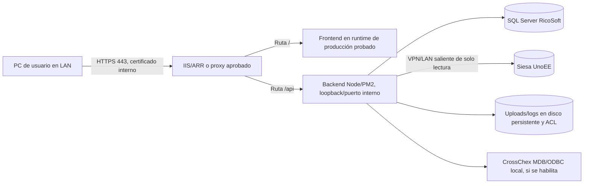

# Análisis de despliegue, cambios, migraciones y escalamiento — RicoSoft

**Fecha:** 2026-10-23
**Base técnica:** código en `main` / `17a48ae`, `server/DEPLOY.md`, `server/ecosystem.config.js`, `server/Dockerfile`, `server/src/index.ts`, `src/config/api.ts`, `vite.config.ts` y `.github/workflows/ci.yml`.
**Contexto operativo aportado por el responsable:** destino previsto `PC-RC-SV`, Windows 11 Pro, acceso interno LAN, proyecto aún no instalado allí. No se verificó el equipo ni su base de datos desde esta auditoría.

## 1. Dictamen de release

**Estado: NO AUTORIZAR aún el despliegue productivo del sistema completo.** El backend tiene una guía Windows + PM2, pero el repositorio no define un procedimiento de publicación/servicio para el frontend ni el montaje de `/Ricosoft`; el cliente apunta por defecto al backend HTTP `http://<hostname>:4000/api`. Para un ERP con JWT y datos de Gestión Humana, HTTP interno no es suficiente protección. Tampoco se verificó esquema/migraciones del servidor destino, backups restaurables ni el Required Status Check en GitHub.

El backend puede prepararse como piloto controlado cuando esos bloqueos se cierren y se complete la prueba de aceptación del entorno. No confundir CI verde con aprobación de producción.

## 2. Lo que existe en el repositorio

- CI GitHub Actions en `.github/workflows/ci.yml`: jobs frontend, backend, integración SQL Server efímera y `CI gate`. El job de integración aplica las migraciones con `prisma migrate deploy` sobre su base efímera y ejecuta pruebas en serie para reducir deadlocks.
- La existencia del job `CI gate` en YAML está confirmada; que GitHub Branch Protection/Ruleset lo exija para fusionar **no se puede demostrar desde el repositorio**.
- Backend: `server/DEPLOY.md` propone Node ≥20, compilación TypeScript y PM2 en Windows; `ecosystem.config.js` fija `instances: 1`, modo `fork`, reinicio automático y logs a archivo.
- Inicio de backend registra cinco schedulers en el mismo proceso: CrossChex, renovación de servicios, ingesta/procesamiento de correo de importaciones y tracking. Además recupera sincronizaciones interrumpidas antes de servir.
- Hay `server/Dockerfile` Linux/Alpine, pero no es una alternativa equivalente ya aprobada para PC-RC-SV: CrossChex usa MDB/ODBC y configuración específica de Windows. La imagen tampoco define volúmenes de uploads/logs ni contiene un despliegue del frontend.
- El frontend raíz tiene `build`, `start: vite preview` y Vite/TanStack Start; el comentario de `vite.config.ts` indica preset Nitro Cloudflare por defecto. No se validó que el artefacto producido arranque como servicio Node/Windows. Debe probarse en el target elegido antes de considerarlo producción.
- `src/config/api.ts` construye por defecto una URL explícita `http://<hostname>:4000/api`; no usa una URL relativa `/api`. `vite.config.ts` no declara `base` ni un basepath TanStack para `/Ricosoft`.
- `server/src/app.ts` exige `CORS_ORIGIN` en producción, configura Helmet y rate limit de login; `/health` solo devuelve `{status:"ok"}` y no comprueba SQL Server, Siesa ni jobs.
- `server/.env.example` existe y declara conexión SQL Server, JWT, CORS, Siesa, CrossChex, jobs de correo/tracking/renovaciones. Los valores reales no deben incorporarse al repo.

## 3. Topología objetivo para LAN interna

**Dirección recomendada:** usar un nombre interno estable (DNS/hosts administrado) y un certificado de CA interna, aunque no exista dominio público. Si se decide solo IP, el certificado debe incluir la IP como SAN y ser confiable en los equipos cliente. Publicar la app detrás de un único origen HTTPS facilita CORS, evita contenido mixto y oculta el puerto del backend. No habilitar port-forwarding desde Internet.

**Ruta:** no desplegar directamente bajo `http://192.168.0.100/Ricosoft` hasta validar/configurar basepath en TanStack/Vite y probar navegación directa/refresco de rutas. La opción mínima es servir en la raíz de un host interno; si se necesita subruta, se vuelve requisito explícito con pruebas de assets, login, refresco, enlaces y API.

**API:** cambiar en una tarea de implementación aprobada a URL relativa `/api` bajo el proxy o fijar `VITE_API_URL` al origen HTTPS real. La configuración actual fuerza `http://` en el fallback; bajo HTTPS el navegador bloquearía fetch como contenido mixto. No resolverlo abriendo CORS a todos los orígenes.

## 4. Riesgos priorizados

| Prioridad | Riesgo/brecha | Efecto | Criterio de cierre |
|---|---|---|---|
| P1 | Frontend de producción y basepath no definidos; fallback API HTTP/puerto 4000. | App no enruta de forma confiable en `/Ricosoft`; JWT/datos viajan sin TLS o se bloquean como mixed content. | Artefacto probado en Windows, ruta final acordada, HTTPS con cert confiable, API mismo origen/HTTPS y smoke test desde otro PC. |
| P1 | Migraciones no verificadas en la BD del futuro servidor. Solo se sabe que el repo contiene 73 carpetas; CI las aplica en una base efímera. | Fallo de arranque, drift o pérdida de disponibilidad al cambiar schema. | Backup probado; identificar nombre/estado del destino; comparar `_prisma_migrations` y schema; desplegar primero a clon QA; revisar SQL; luego RFC y ventana aprobada. |
| P1 | Backup/restore de SQL Server, uploads, `.env` y datos CrossChex no especificado ni probado. | Pérdida de documentos privados/configuración o recuperación incompleta. | RPO/RTO aprobado; backups cifrados fuera de PC-RC-SV; ejercicio de restore verificable. |
| P1 | Branch protection externo a YAML. | Código puede fusionarse aunque `CI gate` no sea requerido. | Confirmar en GitHub Ruleset/Branch protection que `CI gate` es required y que no hay bypass no autorizado. |
| P2 | Runner self-hosted en el mismo servidor de la aplicación no está verificado; el contexto operativo reporta falla al instalar `RunnerService.exe init` con exit `-2146232576`. | Código de workflow ejecuta comandos en el host interno; superficie de compromiso y despliegue accidental. | No usar PC-RC-SV como runner general. Resolver/aislar runner en VM/host de CI con cuenta restringida; limitar repositorio, workflows, labels, secretos y acceso de red; comprobar online antes de depender de él. |
| P2 | Jobs viven en el proceso HTTP. Escalamiento a varias instancias duplica schedulers y puede duplicar efectos. | Correos/tracking/renovaciones repetidas; conflictos y doble notificación. | Mantener una sola instancia o diseñar coordinador/lock distribuido y probar idempotencia antes de escalar horizontalmente. |
| P2 | Archivos y logs dependen de almacenamiento local. | Reinicio, cambio de carpeta o contenedor puede hacer perder adjuntos; backups de DB solos no alcanzan. | Volumen persistente con ACL de mínimo privilegio, backup, restore y política de retención. Nunca servir `uploads` como estático. |
| P2 | `/health` no es readiness; solo indica proceso vivo. | Monitor puede declarar servicio sano aunque SQL, Siesa o jobs estén indisponibles. | Separar liveness de readiness y definir qué dependencia es obligatoria para cada modo. No bloquear liveness por indisponibilidad temporal de Siesa. |
| P2 | Pruebas de integración han tenido deadlocks/write conflicts si se ejecutan en paralelo. | Falsos fallos en QA/CI. | Mantener ejecución secuencial indicada en workflow; recopilar tasa y revisar locks de las suites antes de subir concurrencia. |
| P3 | `README.md` no sirve de guía; documentación de arquitectura antigua contradice el sistema actual. | Operación y cambios se apoyan en instrucciones caducas. | Publicar índice documental nuevo y marcar snapshots antiguos como históricos. |

## 5. Runbook de cambios y migraciones

1. RFC con alcance, riesgo, responsable, ventana, comprobaciones previas, plan de recuperación y aceptación funcional.
2. Confirmar rama/commit aprobado, árbol limpio y pruebas CI requeridas. No desplegar directamente cambios locales sin revisar diff.
3. Obtener backup verificado de base de datos y archivos persistentes; registrar hora y ubicación protegida. Confirmar restore posible antes del cambio.
4. Aplicar migración primero a una base desechable/clon representativo de la versión objetivo: `prisma migrate deploy`, nunca `migrate dev`, `db push` ni reset en producción.
5. Revisar migración SQL manual, índices filtrados, locks, duración, datos duplicados y orden de backfill. Ejecutar checks pre/post y reconciliar `schema.prisma` con la base.
6. En ventana aprobada: detener o poner en mantenimiento el frontend/API según compatibilidad expand-contract; ejecutar migración una sola vez; desplegar build; smoke tests; verificar logs/health, login, cambio de tenant y flujos de alto impacto.
7. Rollback: priorizar reversión de aplicación compatible. Las migraciones de datos/schema no siempre son reversibles; usar migración forward o restaurar backup solo con análisis de pérdida, aprobación y plan de recuperación. No marcar migración `--applied`/`--rolled-back` sin comparar estado físico y registro.
8. Cerrar RFC con versión, checksum de migración, resultado, métricas, incidentes y decisión de conservar/retirar backup conforme a retención.

## 6. Preparación específica de PC-RC-SV

- Confirmar CPU/RAM/disco, parches Windows, reinicio controlado, energía/UPS, firewall, antivirus/EDR, cuenta de servicio y acceso de mínimo privilegio.
- Asegurar conectividad LAN a SQL Server, salida controlada a Workspace si aplica y VPN/ruta hacia Siesa. La caída de Siesa no debe confundirse con caída de RicoSoft; comprobar comportamiento degradado.
- Instalar runtime Node LTS ≥20, npm compatible, PM2; usar `npm ci` (la guía actual dice `npm install`, a unificar), compilar backend y probar inicio/parada/reinicio tras reboot.
- No ejecutar el backend como administrador. Restringir permisos de `.env`, uploads, logs y carpeta de trabajo; no guardar tokens del runner en capturas/documentación.
- Configurar firewall para exponer solo el proxy HTTPS a la LAN autorizada; restringir el puerto 4000 al proxy/local host. Validar que el backend no quede accesible sin TLS desde otros equipos.
- Definir rotación/retención de logs, alertas de disco lleno, expiración/rotación de secretos y custodio de backups.
- Mantener una instancia backend hasta diseñar coordinación de jobs y storage compartido.

## 7. GitHub Actions y runner

La CI usa GitHub-hosted Ubuntu y SQL Server efímero en el workflow. Es preferible mantenerla así si los checks soportan el stack; el self-hosted Windows solo debería usarse para pruebas que requieran Windows/ODBC y sobre un host aislado. Un runner corre código del workflow con permisos del host y no debe compartir credenciales de producción. Si se despliega desde CI, separar “build/test” de “promote/deploy”, requerir aprobación de entorno y usar artefacto inmutable; no hacer que cualquier PR publique al servidor.

## 8. Plan de escalamiento

1. **Vertical primero:** medir CPU, memoria, conexiones SQL, latencia HTTP, duración de endpoints, tamaño de archivos y saturación de disco.
2. **Base de datos:** observar planes/índices con cargas reales; controlar pool/concurrencia SQL Server; vigilar bloqueos P2034/P2028 y tiempos de consultas.
3. **Separar trabajos:** extraer jobs pesados a proceso worker único solo después de diseñar locks, reintentos e idempotencia.
4. **Horizontal API:** solo cuando archivos estén en storage compartido/objeto o un volumen común, sesiones y jobs estén coordinados y se pruebe consistencia multi-tenant. No usar PM2 cluster en el estado actual.
5. **Alta disponibilidad/DR:** segundo host y SQL Server con estrategia de réplica/backup requieren presupuesto, RPO/RTO y operación aprobados; no es una propiedad actual del código.

## 9. Aceptación mínima antes de liberar

- CI completo verde, incluidos integración y `CI gate`; branch protection confirmado en GitHub.
- Build frontend arrancado en el runtime/Windows seleccionado y probado en la URL exacta; typecheck y build backend correctos.
- Migraciones aplicadas en QA representativa y reconciliadas; no hacer `migrate resolve` como sustituto de diagnóstico.
- HTTPS confiable desde cliente LAN; login, cambio de tenant, RBAC, archivos y rutas deep-link probados.
- Conectividad y degradación Siesa; jobs no duplicados; restart/stop ordenado comprobado.
- Backup y restauración de DB + uploads demostrados; plan de rollback y contacto operativo definidos.
- Prueba desde navegador de un segundo equipo; `/health` no es evidencia suficiente de aceptación.
