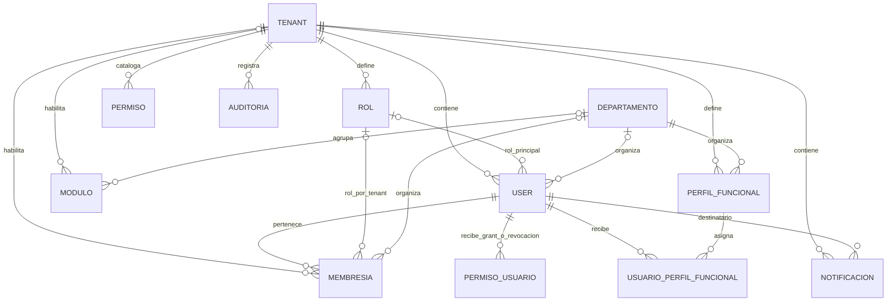
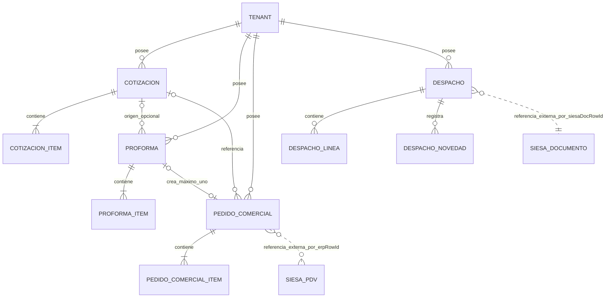
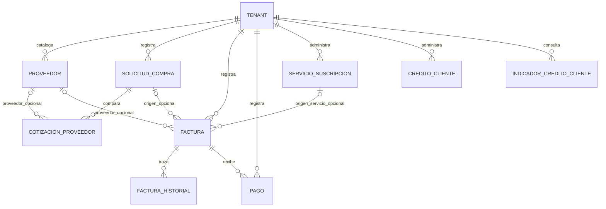
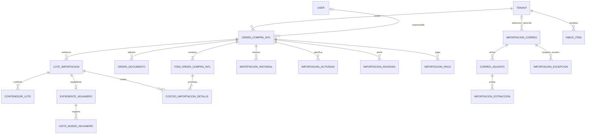
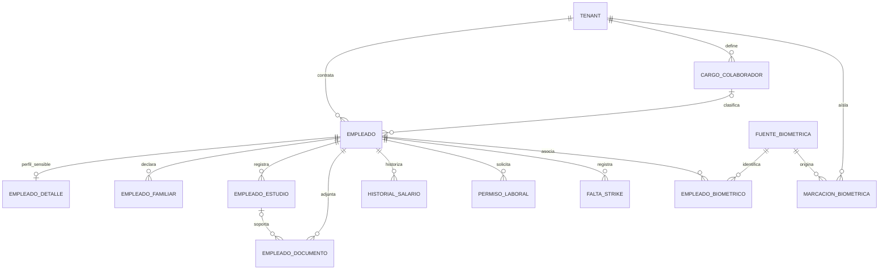

# Modelo Entidad–Relación (MER) lógico — RicoSoft Enterprise

**Fecha:** 2026-10-23
**Fuente:** `server/prisma/schema.prisma` en HEAD `17a48ae`.
**Alcance:** MER lógico de relaciones declaradas por Prisma. No es introspección física del SQL Server del servidor destino y no demuestra que la base desplegada esté alineada.

El schema actual declara 85 modelos. Los diagramas se dividen por dominio para mantener legibilidad. Las líneas hacia Siesa representan referencias externas, no relaciones/FKs Prisma.

## 1. Identidad, tenant y permisos

**Notas del modelo:**

- `Rol.permisos` es JSON/texto con códigos; no hay tabla puente relacional `RolePermission`.
- `Permiso` es un catálogo tenant-scoped. `PermisoUsuario.permisoId` se guarda como código string y no es FK a `Permiso`; la lógica de permisos es la fuente efectiva.
- `User` conserva `tenantId` principal; `Membresia` aporta tenant alterno, rol, departamento y bandera de superadmin del tenant.
- `Auditoria.usuarioId` intencionalmente no tiene FK a `User` para preservar historial tras eliminar usuarios. Las mutaciones históricas están prohibidas salvo purga aprobada por retención.
- `PerfilFuncional.esJefeDeArea` caracteriza perfil/notificación; no es equivalente a permiso ni crea por sí solo una jerarquía de autorización.

## 2. Comercial, cotización, proforma, pedido y despacho

`Cotizacion`, `Proforma` y `PedidoComercial` son cabeceras locales con ítems. Los clientes e ítems Siesa se conservan en gran parte como `rowId` y snapshots; Siesa no es FK de Prisma.

**Relación que no debe inventarse:** el schema no declara FK directa `Despacho → PedidoComercial`. El despacho referencia `siesaDocRowId`; el pedido se vincula por `erpRowId` y la vista de compromiso coteja PDV con lectura del ERP. Son rutas de trazabilidad relacionadas por identificador externo, no una relación local confirmada.

**Restricciones relevantes:** `PedidoComercial(tenantId, numero)` es único; la unicidad de ERP y de `proformaId` usa índices únicos filtrados SQL Server (no representables como `@@unique` simple en este schema). Proforma mantiene unicidad `(tenantId, numero)`.

## 3. Compras, facturación y pagos

La solicitud puede originar factura (FK opcional `Factura.solicitudCompraId`); una factura tiene historial y pagos. El esquema no constituye un libro contable de doble partida. La contabilidad permanece fuera del alcance de una entidad local hasta que exista decisión y diseño explícitos.

## 4. Importaciones y bandeja documental

`ImportacionCorreo.tenantId` es nullable; la unicidad del correo se declara por `messageId` global. Las excepciones tienen también tenant nullable. Debe conservarse verificación de tenant al asignar proveedor/orden y al mostrar/descargar adjuntos; el MER no basta para probarlo.

## 5. Gestión Humana

`Empleado.cargoId` es una FK a `CargoColaborador`, pero no es una FK compuesta con `tenantId`; la coherencia tenant-cargo se valida en aplicación. Los detalles/documentos son sensibles y tienen permisos específicos. Las rutas físicas de archivo no deben exponerse ni servirse como estáticos.

## 6. Cobertura del MER y límites

- Conteo `85` corresponde a declaraciones `model` del schema; los diagramas anteriores son dominios principales, no todos los modelos auxiliares.
- Relaciones opcionales, índices filtrados e identificadores Siesa requieren consultar el texto de schema/migración para cardinalidad real.
- Las tablas de Siesa, CrossChex Access y proveedores externos no forman parte del MER SQL Server de RicoSoft.
- Las claves de negocio representadas como strings (estados, permisos JSON, algunos snapshots) no están normalizadas en todos los dominios.
- Para un ERD físico de producción falta introspección de la base real destino; no se hizo porque no hay autorización ni conexión confirmada a una base desechable de ese servidor.
